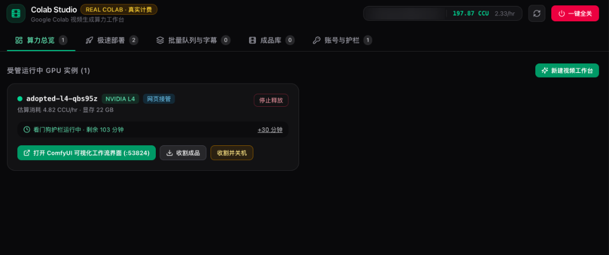
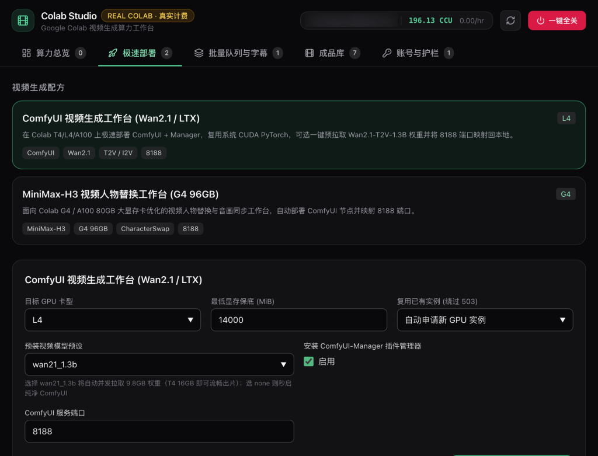
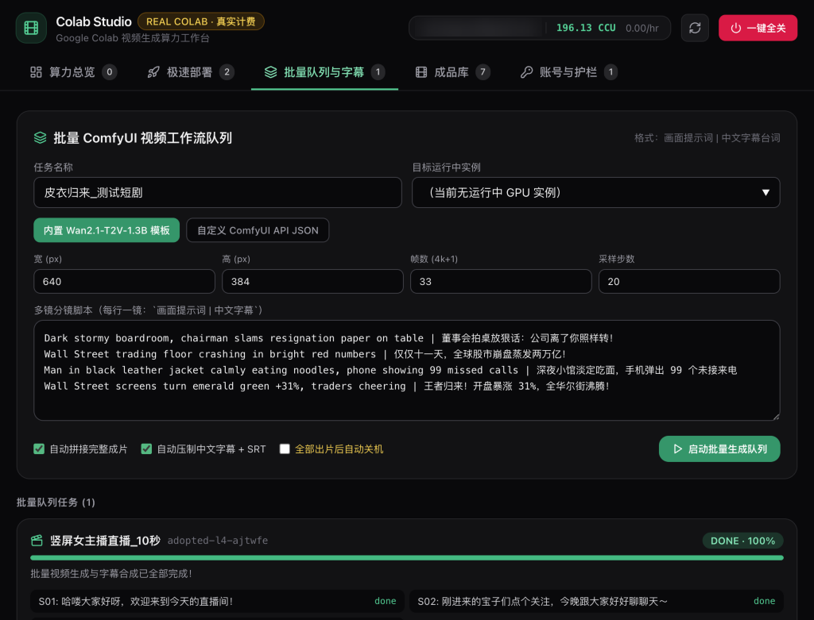
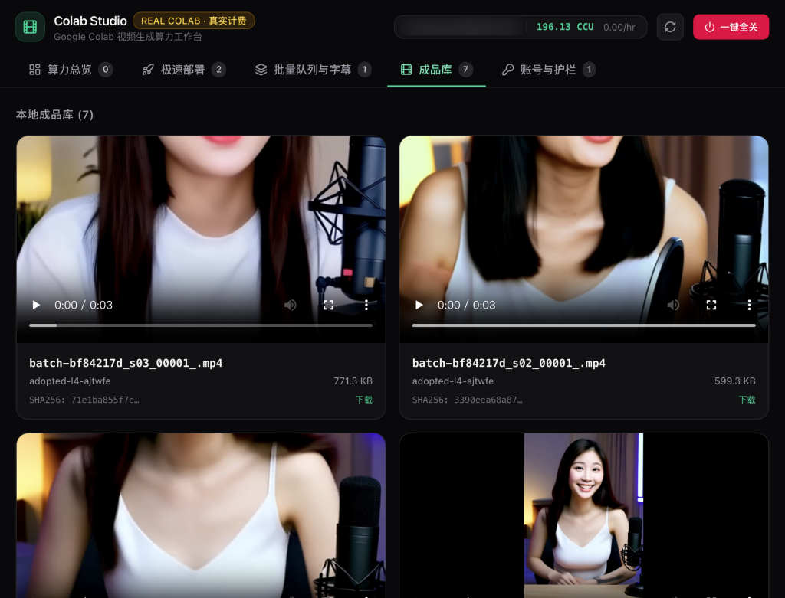

# Colab Studio — Google Colab GPU Video Generation Workbench

[简体中文](./README.md) | **English**

> **Local Control Plane + Cloud Colab GPU Compute**: A cross-platform self-hosted workbench built for AI video generation (ComfyUI / Wan2.1 / MiniMax-H3), featuring a VM-side auto-shutdown cost-guard watchdog, one-click orphan GPU adoption, auto-reconnecting SSH port forwarding, batch ComfyUI workflow queues, and hard-burned CJK subtitles.

---

## Screenshots

| Compute Dashboard (Managed L4 + Watchdog Countdown) | Rapid Deploy Studio (ComfyUI / Wan2.1 / MiniMax-H3) |
| --- | --- |
|  |  |

| Batch ComfyUI Queue & Subtitle Composer | Local Video Outputs Gallery (Inline Player + SHA256) |
| --- | --- |
|  |  |

---

## Key Features

- **First-Class Orphan GPU Adoption + Watchdog Injection**
  - When Colab's `/tun/m/assign` endpoint temporarily returns HTTP 503 during peak demand, spin up a GPU in the Colab web UI and click **Adopt + Attach Watchdog** in Colab Studio to take over the session, inject the auto-shutdown watchdog, and deploy ComfyUI immediately.
- **Two-Layer Cost Guards & Verified Unassign Receipts**
  - **Zero-dependency VM Watchdog (`backend/vm_assets/watchdog.py`)**: Runs inside the Colab VM in a detached process group, monitoring both task heartbeats and `nvidia-smi` GPU utilization. Even if your laptop sleeps or goes offline, idle/expired runtimes automatically call `$TBE_RUNTIME_ADDR/unassign` to stop billing.
  - **Emergency Stop-All & Receipts**: Polls Colab until `assignments` reaches `0` and persists verified shutdown receipts to SQLite.
- **Native OpenSSH over WebSocket Port Forwarding**
  - Generates an isolated Ed25519 keypair and forwards remote ports (e.g. ComfyUI `:8188`) to `127.0.0.1` without touching `~/.ssh/config`.
  - Built-in **5-second auto-reconnect monitor** and automatic **`HTTP 429 already-active-session`** stale `sshd` cleanup & retry.
- **Batch ComfyUI Workflow Queue**
  - Supports both a built-in **Wan2.1-T2V-1.3B** template (one shot per line: `visual prompt | subtitle`) and **custom ComfyUI API JSON** (auto-substituting `{{PROMPT}}`, `{{SEED}}`, and `{{PREFIX}}`).
  - Supports **auto-stitching**, **hard-burned subtitles + `.srt` export**, and **auto-stop GPU after completion**.
- **Universal CJK Subtitle Burner (Pillow + FFmpeg `overlay`)**
  - Auto-detects system CJK fonts (`PingFang SC` / `STHeiti` on macOS, `Noto Sans CJK` on Linux, `Microsoft YaHei` on Windows), renders crisp transparent PNG overlays, and composites them via FFmpeg's universal `overlay` filter—working even on FFmpeg builds without `libass` or `libfreetype`.
- **Multi-Account OS Keyring Vault & Zero-Billing Sandbox Mode**
  - Stores Google OAuth tokens and Hugging Face tokens in the OS Keyring (macOS Keychain / Windows Credential Manager) with zero plaintext token files; `--mock` sandbox mode uses a purely in-memory virtual account and never touches real credentials.

---

## Tech Stack & Project Layout

- **Backend**: Python `>= 3.12` · `uv` · FastAPI · Uvicorn · Pydantic v2 · SQLite (WAL) · `keyring` · `httpx[socks]` · `websocket-client` · Pillow · FFmpeg
- **Frontend**: React 19 · TypeScript · Tailwind CSS v4 · Vite · Lucide Icons

```text
colab-studio/
├── backend/
│   ├── main.py                  # Server entrypoint & CLI subcommands
│   ├── config.py                # Path isolation & HTTP/SOCKS5 proxy handling
│   ├── db.py                    # SQLite (WAL) store for runs, receipts & artifacts
│   ├── models.py                # Pydantic domain models
│   ├── vault.py                 # OS Keyring credential vault & secret redactor
│   ├── backends/
│   │   ├── base.py              # ColabBackend abstraction
│   │   ├── direct.py            # Google Colab HTTPS + Jupyter Kernel WS v5.3 driver
│   │   └── mock.py              # Deterministic zero-billing mock engine
│   ├── ssh_bridge.py            # Isolated keys + OpenSSH -L + auto-reconnect + 429 recovery
│   ├── recipe_loader.py         # Strict TOML recipe validator (blocks reserved port 8080)
│   ├── orchestrator.py          # Provisioning, orphan adoption, deployment, batch queue & harvest
│   ├── video_composer.py        # FFmpeg multi-clip stitcher + Pillow subtitle burner + SRT
│   ├── api/routes.py            # FastAPI REST + WebSocket (/ws/events) + SPA static hosting
│   └── vm_assets/watchdog.py    # Zero-dependency VM-side auto-shutdown watchdog
├── recipes/
│   ├── comfyui-video/           # ComfyUI + Manager + optional Wan2.1-T2V-1.3B preset
│   └── minimax-h3/              # High-VRAM (G4 / A100) video character-swap recipe
├── workflows/
│   └── wan21_livestream_9x16.json  # Example 9:16 portrait Wan2.1 ComfyUI API workflow
├── frontend/                    # React + TypeScript + Tailwind 5-tab Web console
└── tests/
    └── test_studio.py           # Zero-billing end-to-end pytest suite
```

---

## Quick Start

### Prerequisites
- Python `>= 3.12` and [`uv`](https://docs.astral.sh/uv/)
- Node.js `>= 20` (for building the frontend)
- Native OpenSSH (`ssh` / `ssh-keygen`) and `ffmpeg` / `ffprobe`

### 1. Install Dependencies & Build Frontend
```bash
# Install Python backend dependencies
uv sync

# Install & build React frontend (served automatically by FastAPI from frontend/dist)
cd frontend && npm install && npm run build && cd ..
```

### 2. Launch Console
```bash
# Option A: Zero-billing Sandbox mode (try every workflow safely)
uv run colab-studio --mock --port 8770

# Option B: Real Google Colab mode
uv run colab-studio --real --port 8770
```
Open **`http://127.0.0.1:8770`** in your browser:
1. Bind your Google account (and optional Hugging Face token) in **Accounts & Guards**.
2. Deploy `ComfyUI Video Studio (Wan2.1 / LTX)` in **Deploy Studio**, or adopt an existing Colab web GPU in **Dashboard**.
3. Queue multi-shot prompts or custom ComfyUI API JSON in **Batch Queue & Subtitles**, with automatic stitching, subtitle burning, and optional auto-shutdown.

---

## CLI Commands

```bash
uv run colab-studio status
uv run colab-studio adopt <orphan-endpoint>
uv run colab-studio deploy comfyui-video --accel L4
uv run colab-studio harvest <session-name> --auto-stop
uv run colab-studio stop <session-name>
uv run colab-studio stop-all
```

---

## Automated Tests

All tests run in isolated temp directories against the deterministic Mock backend (zero billing, never touches real Google accounts):

```bash
uv run pytest -v
```
