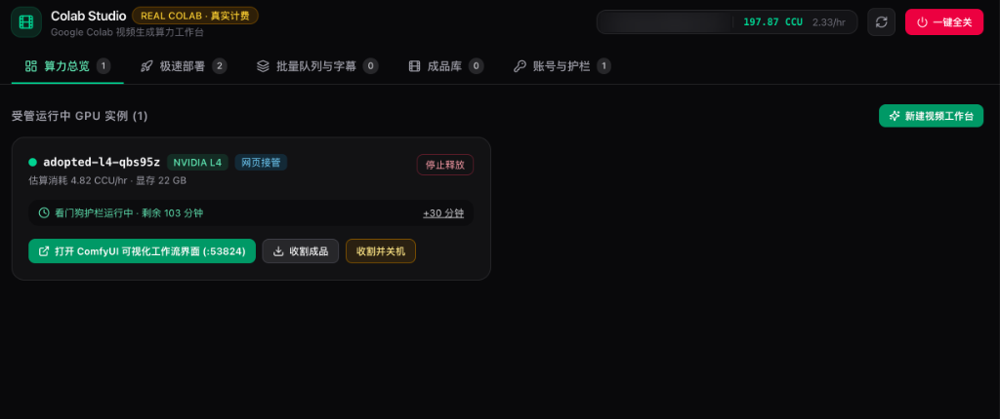
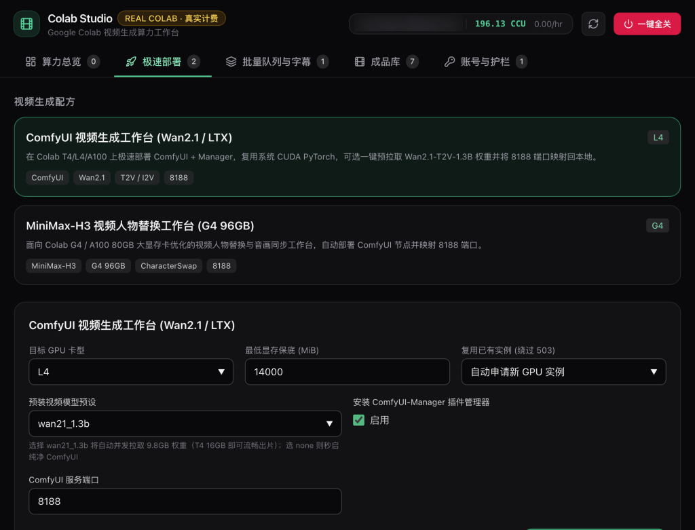
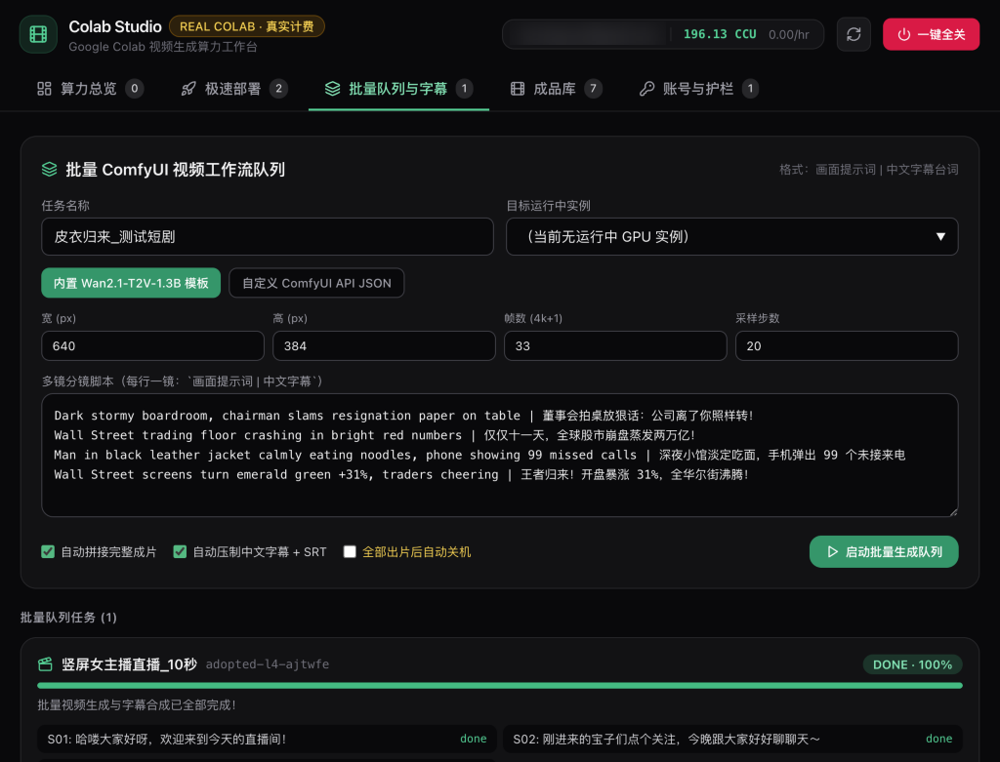

# 黑五白嫖了波 Google Colab 算力不知道怎么花？我撸了个本地 ComfyUI 视频工作台，自带防烧钱看门狗

> **备选标题**：
> - 趁着黑五谷歌送 Colab CCU，开源一个自用的 Colab 视频生成控制台（ComfyUI + 批量队列 + 闲置自动关机）
> - 别让黑五送的 Colab 算力吃灰了！分享个开源小工具：把 Colab 变成带防忘关机护栏的本地视频工作台

最近黑五谷歌活动送了一波 Colab 算力，估计不少佬友手里都突然多了一两百 CCU 吧？

我领完之后第一反应就是拿来跑 **ComfyUI 生视频**，但真上手用 Colab 网页版折腾了两天，血压直接拉满：
- 每次开卡都要重新装依赖、下模型、配端口转发，重复劳动巨烦；
- 跑着跑着 SSH 隧道莫名其妙断了，或者报 `429 already-active-session`；
- **最要命的是忘关机**——浏览器关了以为停了，结果云端 L4 / A100 还在那空转扣 CCU，一觉醒来白嫖的额度直接蒸发一半……

干脆参考社区的一些协议思路，自己从零撸了一套专门面向**视频生成**的本地控制面 + Web 工作台，开源出来大家一起把这波黑五算力用舒服：

👉 **GitHub 地址**：https://github.com/xunxingyuan/Colab-Studio

---

## 这玩意能帮你省哪些心？

### 1. 真·防烧钱看门狗（合盖断网也能停）+ 网页开卡一键接管
不只是本地定时，而是在实例起来时直接往 Colab VM 后台塞一个零依赖的 `watchdog.py`，同时盯任务心跳和 `nvidia-smi` 利用率。哪怕你电脑合盖断网了，GPU 闲置超时它自己会在云端调 `$TBE_RUNTIME_ADDR/unassign` 停机止损（我自己测完忘关 L4，20 分钟一到真帮我自动停了，亲测有效 😂）。

另外用过 Colab 接口的都懂，高峰期调 API 直接开卡偶尔会吃 503。所以我把 **「接管网页端实例」** 做成了一等公民：在 Colab 网页端切出 L4 / A100，控制台会自动检测到它，点一下一键接管就能自动补挂看门狗、实时看 CCU 余额和消耗速率，右上角还有醒目的红色 **「一键全关」**。



---

### 2. ComfyUI + Wan2.1 秒级部署，不占本地硬盘
内置了 **`ComfyUI + Wan2.1-T2V-1.3B`** 和 **`MiniMax-H3`** 视频配方，模型直接走 Google 机房高速出口下在云端盘里（9.8 GB 权重不到 1 分钟就下完，完全不走家里宽带、不占本机空间），通过原生 OpenSSH WebSocket 把云端 `8188` 映射回本地 `127.0.0.1`，并且内置了 **5 秒断线自动重连** 和 **`429` 残留会话自动清理**。



---

### 3. 批量工作流队列 + 中文字幕硬烧录 + 跑完自动关机
不想守在电脑前一条条点？可以直接在 **「批量队列与字幕」** 页按行写 `画面提示词 | 中文字幕台词`（也支持直接粘自己的 ComfyUI API JSON，自动替换 `{{PROMPT}}`、`{{SEED}}`、`{{PREFIX}}`），后台会自动逐镜渲染 → SHA256 下载校验 → 用 `ffmpeg` 拼接成一条完整视频并硬烧录中文字幕（同步输出 `.srt`）。勾上 **「全部出片后自动关机」**，真正实现挂机出片不浪费一分 CCU。



---

### 4. 本地成品库直接在线播放 & 0 计费沙盒体验
生成完的视频片段和拼接好的带字幕成片都会自动落盘到本地 `outputs/` 目录，直接在网页成品库里就能在线预览播放和下载。担心上来就绑 Google 账号不放心的话，默认 `--mock` 模式可以零计费完整点一遍所有流程，顺手了再切真实模式（OAuth 令牌和 HF Token 都加密存在系统钥匙串里，绝不落明文）。


---

## 3 步快速跑起来

技术栈是 **Python (`uv` + FastAPI + SQLite) + React + TypeScript + Tailwind**，macOS / Windows 都能直接跑：

```bash
git clone https://github.com/xunxingyuan/Colab-Studio.git
cd Colab-Studio

# 1. 装后端依赖 & 构建前端
uv sync
cd frontend && npm install && npm run build && cd ..

# 2. 启动（--mock 零计费体验，--real 连真实 Colab）
uv run colab-studio --mock --port 8770
```

启动后浏览器打开 `http://127.0.0.1:8770` 就能看到控制台了。

项目刚开源，代码还很干净，有啥 Bug 或者想加什么视频模型配方，欢迎大家提 Issue / PR，觉得对消耗这波黑五 Colab 算力有帮助的话顺手给个 Star 呀 ⭐️！
